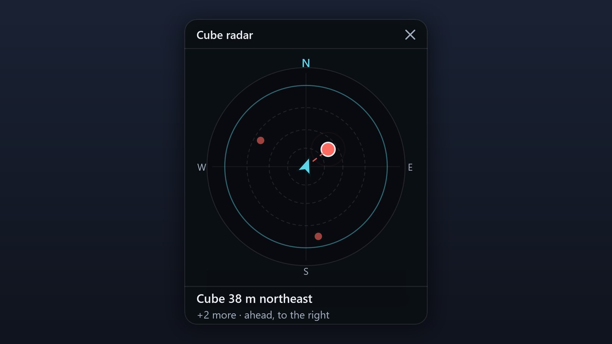
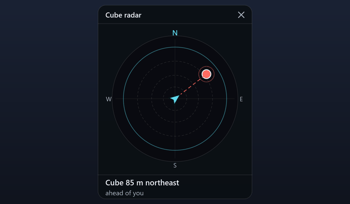

# ⚡ AionCoreUpdate — Real-Time DPS Meter & Radar HUD for Windows 10/11

   

---

AionCoreUpdate is a free Windows companion for Aion 2 that puts a full party DPS meter, a Hidden Cube radar and a control bar right over the game. Track damage, DPS and share per player, then dig into skill breakdowns, boss timers and saved fight history to see exactly where the fight turned. The Cube radar opens on its own when a cube is near, points you to it and calls out distance and direction as you close in. Everything runs from one bar with global shortcuts and out-of-game invite alerts, and it updates itself so you are always on the current build.

## Features

**Party DPS meter**
- One row per player with damage, DPS and share, live as the fight runs. Switch to **HPS**, **APS** (hits per second) or **Taken** for healing, hit counts and damage taken.
- Scope **Me**, **Party**, **Raid** or **Automatic** so the meter always shows the right group without fiddling.
- Click any name for the full skill breakdown: hits, crits, back attacks, multi-hits, average, min and max, a chart and the hit log.
- **Boss timers** built in: Boss HP in numbers, **Kill in** estimated from how fast HP is dropping, and **Enrage in** for bosses with a known enrage timer.
- **Fight history on your PC:** every pull is saved. Open **History**, read the summary, run **Compare fights** against your next attempt, review **Boss runs** and the death recap, and export to JSON, CSV or PNG.
- **Floating party** window keeps your group's health visible without the full meter.
- Five free looks — Stripes, Classic, Dense, Panel and Glass — plus the **Glass finish** over three of them.
- Bottom bar, free in every look: copy the Party's DPS to chat (AionCore copies, you paste) and grab a screenshot of the meter only.

**Hidden Cube radar**
- Opens by itself when the game reports an unopened Hidden Cube near you, and hides about 3 seconds after the last one is gone. Prefer it permanent? Turn on **Keep the radar always visible**.
- **North up**, matching the in-game minimap, or **Turns with you** — your call.
- Multiple cubes: the one you're tracking gets the big dot and the line; the text shows "+N more".
- **Height awareness:** a cube 3 m or more above or below you gets a ▲ or ▼ mark with the distance in meters. Unlock to zoom with the wheel and drag the edges to resize.
- Alerts that actually tell you where to go: at 80, 50, 25 and 10 m, whether the cube is to your right, ahead or behind, and when another player has already opened it.
- Only shows cubes the game sends. The game reports your position on skill or dash use, so with no recent position the radar says "Cube detected" and asks you to move.

**Top bar and main window**
- **Top bar** with one button per tool: meter, floating party, checklist, timers, pet radar, mechanic alerts, dungeon guide and YouTube. Padlock locks everything and clicks pass straight through to the game. Opacity from 20% to 100%, plus a collapsed mode.
- **Main window:** Home shows the countdown to daily and weekly reset, your characters, upcoming events and your last fight. Ctrl+K searches screens and commands. Open it from the bar, the Windows tray or with Ctrl+Alt+A.
- **Stays out of the way:** the bar and overlays hide when another program is in front and when a game menu opens (Esc, map, inventory).
- **Ctrl+Alt shortcuts** that work over the game — M meter, G party, H collapse the bar, L lock, K click-through, D hide everything. If another program already owns one, AionCore offers to remap it.
- Threat, PvP target and Arena sit dimmed on the bar: coming soon.

**Boss mechanics**
- **Mechanics panel** by dungeon: what the boss does and what you should do. Free, with coverage growing every version; mechanics not yet checked in game are marked as such.
- **On-screen mechanic alerts:** one to three words at the top of the screen before the hit lands.

**Out-of-game alerts and shortcuts**
- Alt-tabbed out or game minimized? Party invites, Expedition invites, calls to join and join requests pop up over any window. Click one and AionCore brings the game to the front — it never clicks or accepts anything for you.
- **Global shortcuts** keep every tool one keypress away, whether or not the game has focus.

**Built to keep itself current**
- **Self-updating:** AionCore verifies the installer's digital signature and never installs while Aion 2 is open without asking first. Your settings and fight history survive every version.
- Reads your PC's network traffic and the game window title. No game files touched, no game memory touched, no keys or clicks sent to the game.
- Your fights stay on your PC. Uploading is optional, off by default, and turned off with one click.

## How it works

AionCore runs alongside Aion 2 and reads the game's network traffic — the same packets the client already receives — to build its numbers. Nothing is injected into the game, no files are touched, and no keys or clicks are ever sent. That's why the meter shows exactly what the game reports and tells you when it isn't reading anything.

Party data lands in the meter the moment combat starts: damage, DPS, share, healing, hits and damage taken for every player in scope, updated live. Each fight closes into a saved entry on your PC, so History, Compare fights and Boss runs all work from your own local data — no account required, nothing uploaded unless you explicitly connect one.

The Cube radar hooks the same feed. When the game announces a Hidden Cube near you, the radar opens itself, plots the cube relative to your position and facing, and calls out distance and direction as you close in. It hides again a few seconds after the last cube is gone. Because the game only reports your position when you skill or dash, the radar asks you to move if it has nothing recent to anchor to — that's the game's limit, not a bug.

Everything visual is a Windows overlay: the top bar, the meter, the floating party, the radar. A padlock flips the whole stack into click-through so your mouse goes straight to the game, and the overlays duck out of sight when a game menu opens or another program takes focus. Global Ctrl+Alt shortcuts keep the meter, party, lock and hide functions one keypress away, even mid-fight.

The app updates itself in the background — it verifies the installer's signature and holds the update until Aion 2 is closed, so a patch never eats a fight in progress. Settings and fight history survive every version.

## Supported Games

AionCore is built for Aion 2 on Windows and tuned against the live game — party meter, Hidden Cube radar, boss timers and mechanic alerts all read what Aion 2 actually sends, not a simulation.

- **Aion 2 (Global):** the primary target and where every release is built and tested. Party DPS, HPS, APS and Taken tabs, skill breakdowns, fight history and comparison, boss timers, the Cube radar, the top bar and the global shortcuts are all validated here first.
- **South America servers:** the reference environment. If a metric, timer or radar behaves correctly anywhere, it behaves correctly here.
- **Other regions (Taiwan, Korea):** may work, but are not guaranteed. Packet layouts and boss data can differ, so treat anything outside Global as best-effort until it's confirmed.

One hard requirement applies everywhere: Aion 2 must run in **Borderless window** or **Windowed** mode. Exclusive full screen blocks every overlay Windows tries to draw on top, and that's a Windows rule, not an AionCore setting.

Server-specific behavior — boss enrage timers, mechanic coverage, field boss respawns — grows with each version as data is checked in game. Mechanics that haven't been verified live are marked as such in the panel, so you always know what's confirmed and what's still being validated.

## 📸 Screenshot

## Configuration

Settings live in one place: the gear icon on the bar or Ctrl+K. Everything below applies instantly — no restart, no re-login.

- **Overlay behavior:** opacity from 20% to 100%, collapsed bar mode, and the padlock for click-through. The bar and overlays hide on their own when another window is in front or a game menu opens — toggle that in Settings › In-game.
- **Shortcuts:** Ctrl+Alt defaults (M meter, G party, H collapse, L lock, K click-through, D hide everything) and Ctrl+Alt+A for the main window. Rebind any of them; if another program already owns a combo, AionCore flags it and offers the next free one.
- **Meter:** scope (Me, Party, Raid, Automatic), look (Stripes, Classic, Dense, Panel, Glass), interface scale from 75% to 200% with Ctrl +, Ctrl − and Ctrl 0, and growth direction if you want the meter to climb upward.
- **Radar:** north up or turns with you, keep the cube radar always visible, zoom with the wheel and drag the edges once unlocked. Alert distances and directions for cubes are under Settings › Alerts and events.
- **Out-of-game alerts:** party invites, expedition invites, calls to join and join requests. Pick what pops up over other windows and what stays quiet.
- **Pets:** the pet radar ships turned off. Flip it on when you want nearby soul drops listed.
- **Account and upload:** connecting is optional. When connected, a notice shows what goes out and boss fight uploading turns on — one click turns it back off.

Your settings and fight history carry over between versions. Nothing is written to the game folder; the config stays on your PC.

## FAQ

**Can I get banned?**

AionCore reads your PC's network traffic and the game window title. It does not touch game files or game memory. It sends no keys or clicks to the game: copying DPS to chat only copies it, and you paste it yourself. That said, no tool of this kind can guarantee what the game's policy decides: use it at your own risk.

**Does AionCore read what I type?**

No. With **In the game menus** on and AionCore running as administrator, it checks only whether the Alt and Esc keys are pressed, and only while Aion 2 is in front, to know whether a game menu opened. No other key is read, and nothing is recorded or sent. Turn it off in **Settings › In-game**.

**Which servers and regions work?**

Built and tested on Aion 2 Global (South America servers). Other regions (Taiwan, Korea) may work, but are not guaranteed yet.

**Is the meter accurate?**

It counts what the game sends. In some cases the meter cannot see everything, and it tells you when it is not reading the game.

**Do I need to run it as administrator?**

Not by default: AionCore installs for your user only and opens without asking for administrator rights. Three cases change that:

- If your Npcap was installed with *Restrict Npcap driver's access to Administrators only*, the meter shows a **Reopen as administrator** button (that time only). To never need it, reinstall Npcap without that option.
- **In the game menus** (hide the bar and the overlays when a game menu opens): to see whether Alt and Esc are pressed while the game is in front, AionCore must run as administrator. Without that, it goes by the game's cursor.
- If Aion 2 runs as administrator, clicking an out-of-game alert brings the game to the front only when AionCore runs as administrator too.

For these cases there is **Settings › General › Open AionCore as administrator**, off by default. When you turn it on, Windows asks for permission (UAC).

**The bar or the meter disappears when the game is in front.**

The game is in exclusive **Full screen**, and Windows shows no window on top of it. In Aion 2's video options, switch to **Borderless window**.

**Windows or my antivirus warned me during install.**

The installer has no paid code-signing certificate, so Windows does not know the publisher and shows "Windows protected your PC". Click **More info**, then **Run anyway**. An antivirus may ask for confirmation for the same reason. To check that the file is the original, compare the `sha256` value in `latest.json` (in the Assets of the latest release) with the output of `Get-FileHash .\AionCore-Setup.exe`.

**What leaves my PC?**

Without a connected account, no fight leaves your PC. AionCore downloads skill icons from the game's CDN and checks the update repository for new versions. With an account connected, boss fights and inspections go to aioncore.app, as the notice says before it turns on; turn it off in **Settings › Account and upload**. The profile lookup on the applicant card sends only name and server (turn it off in **Settings › Alerts and events › Party invite**).

**How do I uninstall? Do I lose my data?**

*Windows Settings › Installed apps › AionCore*. The uninstaller asks whether to delete your data too (history, settings); by default it keeps them. Installing a new version over the old one also keeps everything.

**Is it official? Is the code open?**

No to both. AionCore is an independent project made by a player, not affiliated with the game's publisher.

## Disclaimer

AionCoreUpdate is an independent, player-made tool. It is not affiliated with, endorsed by, or sponsored by the developers or publishers of Aion 2. All game names, logos and trademarks belong to their respective owners.

AionCoreUpdate reads your PC's network traffic and the game window title. It does not modify game files or game memory, and it sends no keys or clicks to the game. That said, no third-party tool can guarantee how the game's policy will be applied: use it at your own risk.

The meter shows what the game reports over the network. When it cannot see everything, it tells you so instead of guessing. Numbers are a training aid, not an official scoreboard.

Your fights stay on your PC. Without a connected account, no fight data leaves your machine. Connecting an account is optional, and uploads can be turned off at any time in the app's settings.

AionCoreUpdate is provided as-is, with no warranty of any kind. You are responsible for how you use it and for staying within the rules of the game and the terms of any service you play on.

